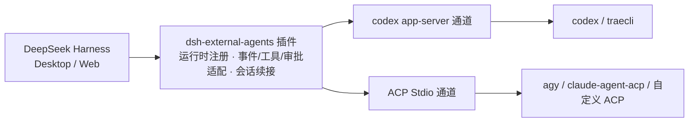

# dsh-external-agents

为 [DeepSeek Harness (DSH)](https://github.com/deepseek-ai/deepseek-harness) Desktop 与 Web 提供可插拔的外部 CLI Agent 运行时：**Codex**、**Antigravity**、**Claude Code**、**TRAE CLI (`traecli`)**，以及自定义 `codex-app-server` / ACP 协议 CLI。

## 特性

- **不侵入 DSH 原生配置**：保留全部原生预设与默认模型，仅在安装后扩展可选的外部 Agent 预设。
- **开箱支持四种外部 CLI**：
  - **Codex**（`codex app-server --stdio`）：支持推理强度调节与会话断线续接。
  - **Antigravity**（`agy acp --stdio`）：支持多模型切换与本机钥匙串环境隔离。
  - **Claude Code**（`@agentclientprotocol/claude-agent-acp`）：支持流式输出与工具调用。
  - **TRAE CLI**（`traecli app-server --listen stdio://`）：自动识别 `traecli` / `trae-cli`，支持多模型与推理强度。
- **原生交互体验**：支持流式推理、工具调用卡片、审批与提问、按预设自动过滤模型列表，以及跨重启恢复会话。
- **零运行期外部依赖**：与 [dsh-lark-bridge](https://github.com/harryzhz/dsh-lark-bridge) 同时安装后可自动发现，无需额外配置。

## 架构



## 前置准备

- `Node.js >= 22.0.0`
- `DeepSeek Harness >= 0.2.2-rc.5`（macOS / Windows / Linux）
- 在本机安装并登录至少一个外部 CLI：

| 运行时 | 默认命令 | 说明 |
| --- | --- | --- |
| **Codex** | `codex` | OpenAI Codex CLI（`codex app-server --stdio`） |
| **Antigravity** | `agy` | Antigravity CLI（`agy acp --stdio`） |
| **Claude Code** | `npx` | 通过 `@agentclientprotocol/claude-agent-acp` 接入（需已登录 Claude Code） |
| **TRAE CLI** | `traecli` / `trae-cli` | TRAE CLI（[trae.cn](https://www.trae.cn)） |

## 安装与使用

### 方式一：DSH 界面安装（Desktop / Web）

1. 打开侧边栏 **插件 → 添加插件**。
2. 填入任一安装源并点击 **安装**：
   - **GitHub Release `.tgz`（推荐，免构建脚本）**：`https://github.com/harryzhz/dsh-external-agents/releases/latest/download/dsh-external-agents.tgz`
   - **GitHub 仓库**：`github:harryzhz/dsh-external-agents`（或 `https://github.com/harryzhz/dsh-external-agents`；pnpm ≥ 10 首次会拦截 `prepare` 脚本，按界面提示点击 **允许这些脚本并重试**）
   - **本地源码目录**：先在仓库运行 `pnpm install && pnpm build`，再填入绝对路径
3. 点击 **立即启用**，并 **重启一次 DSH** 让外部运行时生效。

### 方式二：`dsh plugin` CLI 安装（Web / Headless / SDK / ACP）

> `--profile <name>` 须写在 `add` / `remove` 之前。`desktop` profile 由桌面端托管，请使用上方界面安装。

```bash
# 从 GitHub Release latest .tgz 安装（推荐，免构建脚本）
dsh plugin --profile web add https://github.com/harryzhz/dsh-external-agents/releases/latest/download/dsh-external-agents.tgz

# 从 GitHub 仓库安装（也可使用 https://github.com/harryzhz/dsh-external-agents）
dsh plugin --profile web add github:harryzhz/dsh-external-agents

# 从本地已构建仓库安装
dsh plugin --profile web add file:/absolute/path/to/dsh-external-agents
```

从 Git 仓库安装时，若 pnpm ≥ 10 拦截了 `prepare` 脚本，将以下内容写入 `$DSH_HOME/profiles/<name>/pnpm-workspace.yaml` 后重试 `add`：

```yaml
allowBuilds:
  '@harryzhz/dsh-external-agents': true
```

校验、启动与维护命令：

```bash
dsh --profile web --dump-config                               # 校验配置层已挂载
dsh web                                                       # 启动或重启使运行时生效
dsh plugin --profile web update @harryzhz/dsh-external-agents # 更新
dsh plugin --profile web remove @harryzhz/dsh-external-agents # 卸载
```

### 切换预设与自定义运行时

重启 DSH 后，在会话内即可切换 `Codex`、`Antigravity`、`ClaudeCode`、`TRAE` 预设，模型列表会按当前预设自动过滤。

如需禁用某内置运行时、修改启动参数，或接入自定义 ACP / `codex-app-server` CLI，在 `$DSH_HOME/profiles/<name>/cordis.patch.yml` 中追加覆盖项即可：

```yaml
- id: dsh-external-agents
  config:
    runtimes:
      - id: trae
        enabled: false
      - id: my-acp-agent
        kind: acp
        displayName: My ACP Agent
        command: my-acp-cli
        args: ['--acp']

# 禁用内置运行时后可同步隐藏对应预设
- id: preset-trae
  disabled: true

# 新增非内置运行时 id 时，同步声明对应预设
- insert:
    - id: preset-my-acp-agent
      name: '@deepseek-ai/dsh-agent-preset'
      config:
        id: my-acp-agent
        name: My ACP Agent
        order: 20
        plugins: []
```

## 搭配 `dsh-lark-bridge` 使用

与 [dsh-lark-bridge](https://github.com/harryzhz/dsh-lark-bridge) 一起安装后（例如 `dsh plugin --profile web add https://github.com/harryzhz/dsh-external-agents/releases/latest/download/dsh-external-agents.tgz https://github.com/harryzhz/dsh-lark-bridge/releases/latest/download/dsh-lark-bridge.tgz`），重启 DSH 即可在飞书智能体和群聊配置中直接选择外部运行时与模型，实景效果可参考 `dsh-lark-bridge` 仓库中的产品演示视频。

## 开发与打包

```bash
pnpm install
pnpm build
pnpm typecheck
pnpm test

# 打包 .tgz（输出到 .local/releases/）
pnpm run pack:bundle

# 安装当前本地仓库到 DSH web profile 联调
dsh plugin --profile web add "file:$(pwd)"
```

## License

[MIT](./LICENSE)
