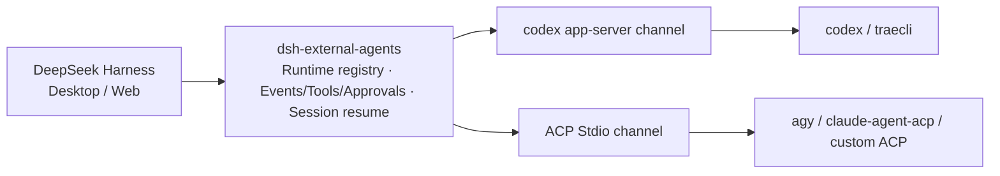

<div align="center">
  <h1>dsh-external-agents</h1>
  <p><strong>Run Claude Code, Codex, Antigravity & TRAE CLI inside DeepSeek Harness (Desktop & Web) — zero-intrusion external Agent runtime plugin</strong></p>
  <p>
    <a href="https://github.com/harryzhz/dsh-external-agents/releases/latest"></a>
    <a href="./LICENSE"></a>
    <a href="https://github.com/harryzhz/dsh-external-agents/stargazers"></a>
  </p>
  <p>
    <a href="./README.md">简体中文</a> · <strong>English</strong>
  </p>
</div>

Plug-in external CLI Agent runtimes for [DeepSeek Harness (DSH)](https://github.com/deepseek-ai/deepseek-harness) Desktop and Web: **Codex**, **Antigravity**, **Claude Code**, **TRAE CLI (`traecli`)**, plus any custom `codex-app-server` or ACP-compatible CLI. Pair with [harryzhz/dsh-lark-bridge](https://github.com/harryzhz/dsh-lark-bridge) to bring all of your local coding agents straight into Feishu/Lark group chats.

## Features

- **Zero intrusion on DSH native presets**: Keeps all built-in presets and default models intact while extending selectable external runtimes.
- **4 Coding CLIs out of the box**:
  - **Codex** (`codex app-server --stdio`): reasoning-effort control & seamless session resume.
  - **Antigravity** (`agy acp --stdio`): multi-model switching & isolated keychain environment.
  - **Claude Code** (`@agentclientprotocol/claude-agent-acp`): streaming reasoning & tool execution cards.
  - **TRAE CLI** (`traecli app-server --listen stdio://`): auto-detects `traecli` / `trae-cli` with multi-model and reasoning effort support.
- **Native DSH UX**: Streaming thoughts, tool call cards, interactive approvals/prompts, preset-scoped model filtering, and cross-restart session continuity.
- **Zero runtime dependencies**: Auto-discovered by [dsh-lark-bridge](https://github.com/harryzhz/dsh-lark-bridge) with no extra glue config.

## Architecture



## Prerequisites

- `Node.js >= 22.0.0`
- `DeepSeek Harness >= 0.2.2-rc.5` (macOS / Windows / Linux)
- At least one external CLI installed and signed in locally:

| Runtime | Default Command | Notes |
| --- | --- | --- |
| **Codex** | `codex` | OpenAI Codex CLI (`codex app-server --stdio`) |
| **Antigravity** | `agy` | Antigravity CLI (`agy acp --stdio`) |
| **Claude Code** | `npx` | Via `@agentclientprotocol/claude-agent-acp` (requires logged-in Claude Code) |
| **TRAE CLI** | `traecli` / `trae-cli` | TRAE CLI ([trae.cn](https://www.trae.cn)) |

## Installation

### Option 1: One-Line Full Stack Installer (DSH + Both Plugins, Recommended)

```bash
# macOS / Linux (interactive or pass -s -- --mode web|app|both)
curl -fsSL https://raw.githubusercontent.com/harryzhz/dsh-lark-bridge/main/scripts/install.sh | bash
```

```powershell
# Windows (PowerShell)
irm https://raw.githubusercontent.com/harryzhz/dsh-lark-bridge/main/scripts/install.ps1 | iex
```

### Option 2: DSH UI (Desktop / Web)

1. Open **Plugins → Add Plugin** in the sidebar.
2. Paste the GitHub Release `.tgz` URL (recommended, no build scripts needed):
   `https://github.com/harryzhz/dsh-external-agents/releases/latest/download/dsh-external-agents.tgz`
3. Click **Enable** and restart DSH once for external runtimes to register.

### Option 3: `dsh plugin` CLI (Web / Headless)

```bash
dsh plugin --profile web add https://github.com/harryzhz/dsh-external-agents/releases/latest/download/dsh-external-agents.tgz
dsh --profile web --dump-config
dsh web
```

### Customizing Runtimes

Disable built-in runtimes or register your own ACP / `codex-app-server` CLI in `$DSH_HOME/profiles/<name>/cordis.patch.yml`:

```yaml
- id: dsh-external-agents
  config:
    runtimes:
      - id: trae
        enabled: false
      - id: my-acp-agent
        kind: acp
        displayName: My ACP Agent
        command: my-acp-cli
        args: ['--acp']
```

## Development & Packaging

```bash
pnpm install
pnpm build && pnpm typecheck && pnpm test && pnpm run check:privacy
pnpm run pack:bundle
```

## License

[MIT](./LICENSE)
