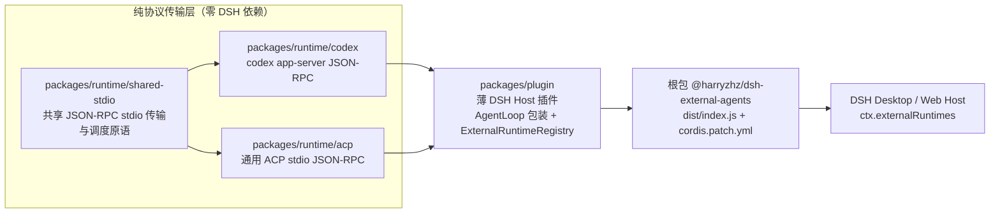

# 架构分层与工程约束

本文档说明 `dsh-external-agents` 的防腐层模块划分、协议包目录组织规范以及运行时工程约束。

## 1. 仓库分层（防腐层架构）



| 模块路径 | 包名 | 职责与边界 |
| --- | --- | --- |
| `packages/runtime/shared-stdio` | `@dsh-external-agents/runtime-shared-stdio` | 零外部依赖的共享 JSON-RPC stdio 传输基类（EPIPE 防护、单实例 `terminateChild()`、行缓冲与超时清理）、`JsonRpcDispatcher` 请求调度与环境/路径清洗原语（**零 DSH 依赖**） |
| `packages/runtime/codex` | `@dsh-external-agents/runtime-codex` | 纯 TS `codex app-server` JSON-RPC 客户端（**零 DSH 依赖**） |
| `packages/runtime/acp` | `@dsh-external-agents/runtime-acp` | 纯 TS 通用 ACP（Agent Client Protocol）stdio JSON-RPC 客户端，支持能力协商与 `session/resume` → `session/load` → `session/new` 自动回退（**零 DSH 依赖**） |
| `packages/plugin` | `@dsh-external-agents/plugin` | 薄 DSH Host 插件：包装 `AgentLoop`、通过 `ExternalRuntimeRegistry` 统一管理可插拔外部运行时与启动配置、映射流式事件/工具调用/审批/提问并发布 `ctx.externalRuntimes` |
| 根包（`package.json` + `cordis.patch.yml` + `scripts/prepare.mjs`） | `@harryzhz/dsh-external-agents` | 面向 DSH Desktop / Web「添加插件」发布的零运行期依赖独立 Bundle（支持 GitHub 仓库直装 / Release `.tgz` / 本地目录安装） |

## 2. 运行时协议目录规范

所有纯协议/传输层运行时客户端一律归口至 `packages/runtime/<protocol>/`（当前为 `packages/runtime/codex`、`packages/runtime/acp`，以及后续新增的其他协议），**禁止**以 `packages/runtime-<protocol>` 平铺在 `packages/` 根目录：

1. **包名与可见性**：统一命名为 `@dsh-external-agents/runtime-<protocol>`，并标记 `"private": true`。
2. **TypeScript 配置**：`tsconfig.json` 统一继承 `../../../tsconfig.base.json`。
3. **Workspace 规则**：`pnpm-workspace.yaml` 保持以下匹配模式：
   ```yaml
   packages:
     - 'packages/*'
     - '!packages/runtime'
     - 'packages/runtime/*'
   ```
4. **插件引用与打包别名**：新增协议包时，必须同步完成两处登记：
   - `packages/plugin/package.json` 中添加 `"@dsh-external-agents/runtime-<protocol>": "file:../runtime/<protocol>"`；
   - `scripts/prepare.mjs` 的 `workspaceAliasPlugin` 中登记对应别名映射。

## 3. 核心工程与运行时约束

- **严格单向依赖**：核心协议层（`packages/runtime/*`）不得反向依赖任何 `@deepseek-ai/*` 包。
- **非侵入 `cordis.patch.yml`**：根包 `cordis.patch.yml` 仅禁用并包装 `agent-loop` 及追加外部运行时预设，**禁止**覆盖用户默认的 `agent-default-model`、`agent-preset-registry.default`、`session-title-llm` 或 `ui-settings-general`。
- **零运行期外部依赖**：根包 `package.json` 必须保持 `dependencies: {}`，且 `devDependencies` 不引入 `@deepseek-ai/*`，确保用户通过 Git 仓库直装时 `prepare` 脚本极速构建。
- **macOS Keychain 环境隔离**：启动依赖 macOS Keychain 的子进程（如 `agy acp`）时启用 `stripSshEnv: true`，剥离 `SSH_CONNECTION` / `SSH_CLIENT` / `SSH_TTY`（保留 `SSH_AUTH_SOCK`）。
- **ACP 进程池与隔离数据目录**：对于内部维护共享会话存储的 ACP 运行时（如 `agy acp`），`AcpRuntimePool` 按 `(DSH 实例, runtime, profile)` 复用单个 `agy acp --stdio` 进程并多路复用并发会话，自动注入隔离的相对 `--app-data-dir`（保留宿主 `~/.gemini` 凭据与镜像 `settings.json`，并在恢复升级前的遗留会话时从 `~/.gemini/antigravity-cli/` 按需只读迁入单会话存储；若服务端 `session/resume` 提示改用 `session/load` 则自动降级并由 `-32002` 兜底 `session/new`），冷态模型探测使用临时隔离目录并在退出后清理，避免跨进程互相 `Resuming conversation` 踩踏在途工具步；同时在 `ExternalRuntimeRegistry` 维护 `externalId → sessionId` 映射以支持上游按外部会话 ID 反查归属。
- **Codex 冷恢复参数保护**：启动 `codex app-server` 冷恢复 `thread/resume` 时，除非用户显式切换模型，不得重传 `model` / `reasoning_effort` 覆盖参数。
